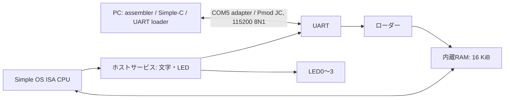

# Simple OS CPUとArty S7入出力のVHDL実装

独立した実験用CPUであり、w11のRTLは変更しない。仕様の整理は [開発資料](docs/README.md) を参照する。

## 現在の到達点

`rtl/simpleos_cpu.vhd` は複数クロックで一命令を実行する。基本の転送・算術・論理・条件分岐、CALL/RET、PUSH/POP、1/2/4バイトのメモリー操作、EI/DI、ホストサービス要求を実装した。メモリーとサービスにはvalid/readyによる待ち合わせがあり、要求中は番地・データを保持する。メモリーアダプターがビッグエンディアンの値を返す契約である。

`simpleos_mmu.vhd` は命令開始時に16バイトのページ表を読み込み、命令実行・例外フレーム保存・IRET中はその表を保持する。1/2/4バイトのアクセスをビッグエンディアンのバイト転送へ分解し、非整列・ページ境界のフォルトと部分書込みを扱う。CPUにはページフォルト、フォルト番地取得（SYSCALL 41）、外部割込み受付、IRETを追加した。例外フレーム保存中の再フォルトは診断停止する。

`simpleos_timer.vhd` は100ms周期の割込みを生成し、有効中のtickを有限キューへ積む。停止中のtickは追加せず、既存の保留は残す。キューあふれは出力で検出する。CPUの割込み入力とackへ接続する部品として用意しており、OS比較試験では同じ命令境界で割込みを注入して再現性を確保した。

`simpleos_uart.vhd` は送受信独立の8N1 UART。2段入力同期、受信1バイト保持、ready/valid、フレーミング異常・受信あふれ検出を備える。OS向けのホストパケット、転送DMA、DDR3アダプターはまだ追加していない。MUL/DIV/MODは32回の逐次演算器へ置き換え、CPU・RAM・UART統合回路の合成評価を行った。

## 比較試験

期待値は公開元Python CPUの実行関数から作る。`base.asm` のSYSCALL 20で全16レジスタを記録し、VHDLテストベンチが同じ位置で比較する。命令全件の網羅試験ではない。現在は20か所・320比較で、桁あふれ、フラグだけの演算、論理演算、乗除算、条件分岐、非整列・64KiB境界をまたぐ物理アクセス、PUSH SP、CALL/RETを含む。メモリーは3クロックに1回だけ応答し、サービス応答も遅らせる。

Simple-Cを指定すると、公開サンプル `test_bitops.c` を実際にコンパイルし、生成したmainを比較試験からCALLする。戻り値189をPython版で確認し、VHDLでは全レジスタを照合する。合計21か所・336比較となる。

固定版：

- os_book_code：`d377b03a8ca71f443474fa6c549fd710deaafedf`
- Simple-C：`a970ef6736a64916c8659be33403d76b1ba4ff6f`

Simple-Cは上流`5542998`に改行修正パッチを適用する。固定した新しい上流版との差分を確認し、asm.pyとos.asmは同一、emu.pyは同じ改行修正2か所だけだった。今回のCPU試験とのISA差はない。

## 再実行

両リポジトリを上記の固定版へチェックアウトした後、プロジェクトのルートで実行する。コンパイラーは指定されたSimple-Cツリーのsamples/test_bitops.asmを再生成するため、専用の取得先を使う。

```sh
bash tests/prepare.sh /tmp/os-book-isa-review /tmp/simple-c-isa-review
```

表示された一時ディレクトリへ移り、表示されたxsimコマンドを別に実行する。Vivadoの場所は `SIMPLEOS_VIVADO_BIN` で変更できる。終了コードだけで判定せず、`PASS: 21 checkpoints, 336 register comparisons` と、Failure/ERRORがないことを確認する。

この環境では、xelab直後に同じシェルスクリプトからxsimを起動するとTclのunexpected exceptionが発生した。原因は未特定。同じスナップショットを別のコマンドとして起動すると正常に完了したため、準備と実行を分けて記載する。

## 2026-10-12の確認

Vivado Simulator 2022.1で以下が合格した。OS試験はサービス呼出し時の全16レジスタと、終了時の主記憶1MiB全体をPython版と比較する。

| 試験 | レジスタ比較 | 結果と範囲 |
| --- | --- | --- |
| 基本ISA＋Simple-Cのビット演算 | 21か所・336個 | メモリー待ち・スタック・演算・分岐 |
| 例外 | 11か所・176個 | タイマー割込み注入、データ・境界書込み・命令フェッチのフォルト、IRET、ページ表変更 |
| 元のOSの起動・exit | 19か所・304個 | MMU有効化、入力、終了 |
| 元のOSでtaskexec pagefault.bin | 96か所・1536個 | タスク0→1→0、7回のタイマー割込み、ページ割当て、再実行、終了 |
| C版OSでtaskexec pagefault.bin | 97か所・1552個 | C版のコマンド処理・スケジューラ・ページ割当てを含む同じ経路 |
| UART・LED・タイマー | ワイヤーと状態の試験 | 115200 bpsのエコー00/55/AA/FF/41、短い偽スタート、異常stop、受信あふれ、LED周期・通信表示、タイマー保留・あふれ・無効化 |

ログ・実装レポートは [tests/evidence](tests/evidence/) に保存した。初回の [基本ISAログ](tests/validation-2026-10-12.log) も残す。

OS比較試験の入出力・時刻は固定した模擬ホスト応答である。タスクのバイナリーは事前に主記憶へ置き、Python側のロードと同じ配置を作る。UARTから実際にファイルを転送しているわけではない。表示用の文字列ポインター・引数は比較するが、RTLから文字列をUARTへ流す経路はまだない。UART確認用bitstreamとOSのシミュレーションを混同しない。

例外・元のOS・C版OSの再実行：

```sh
bash tests/prepare_system.sh /tmp/os-book-isa-review exceptions
bash tests/prepare_system.sh /tmp/os-book-isa-review os
bash tests/prepare_system.sh /tmp/os-book-isa-review tasks
# Simple-Cでtools/build_simple_os.pyを実行した専用ツリーを指定する。
bash tests/prepare_system.sh /tmp/os-book-isa-review c-tasks /tmp/simple-c-isa-review
bash tests/prepare_io.sh
```

各準備スクリプトが表示するxsimコマンドを別に実行し、PASSとFailure/ERRORがないことを確認する。タスク試験は例外試験より長く、上限20msのシミュレーション時間を設ける。C版は約10.19msで完了した。

## LED点滅とUARTのArty S7-50用bitstream

`rtl/simpleos_io_demo.vhd` は独立した接続確認用トップで、CPUやOSは含まない。基板の100MHzクロックを用い、LED0を0.5秒ごとに反転（1秒周期）し、USB-UARTから受けたバイトを115200 bps・8N1でそのまま送り返す。

| LED | 表示 |
| --- | --- |
| LED0 | 周期点滅 |
| LED1 | エコー送信開始ごとに反転 |
| LED2 | 受信stopビット異常（resetまで保持） |
| LED3 | 受信バッファあふれ（resetまで保持） |

BTN0でresetする。UARTはArty S7内蔵USB-UARTのV12/R12を使用し、Pmod端子ではない。端末側のローカルエコーを無効にすると、FPGAから返った文字を確認できる。

生成したbitstream：`build/io/simpleos_io_demo.bit`（Arty S7-50専用）。SHA-256：`2181024c6f01c4ddd5d689ec85fb7e499303f200160f166f1942ffc37d4cd9a7`。

再ビルド：

```sh
/home/itoh/Xilinx/Vivado/2022.1/bin/vivado -mode batch \
  -source board/build_io.tcl \
  -tclargs /tmp/simpleos-io-build
```

合成・配置配線・bitstream生成まで成功。77 LUT、91 FF、WNS +4.708ns、WHS +0.131ns、setup/hold違反0、最終DRC違反0。構成電圧は既存Arty S7制約と同じCFGBVS=VCCO、3.3Vを設定した。非同期UART・ボタン・LEDには外部クロックに対する入出力delayを設定していないため、レポートのno_input_delay/no_output_delayに出る。内部の未制約endpointは0。

2026年10月12日、Arty S7-50（シリアル番号210352B0BF4AA）へのJTAG構成と起動完了を確認した。実UARTは115200 bps・8N1でASCII 16バイトと全バイト値256バイトの計272バイトを送受信し、エコーが完全一致した。ログは `tests/evidence/jtag.log` と `tests/evidence/uart-hardware.log`。ユーザーから動作確認の了承を得た。フラッシュには保存していない。

CPUのホストサービスとUARTをつなぐ転送処理・文字出力・LED制御は、以下の内蔵RAM構成で実装した。OS実行用の主記憶DDR3接続は次の段階で行う。

## UARTでサンプルをロードするCPU構成

`simpleos_board.vhd` はCPU・内蔵RAM・UARTローダー・文字出力を組み合わせる。
`simpleos_io_demo.bit` とは別の回路であり、エコー用bitstreamではサンプルを実行できない。



コード領域は物理番地 `0x80000..0x81FFF`（8 KiB）、スタック領域は
`0xFE000..0xFFFFF`（8 KiB）。起動番地は `0x80000`、初期SPは `0xFF000`。
RAMは二つの領域を別々に配置し、領域外アクセスはNAKを返して停止する。
UARTは外付けUSB-TTLアダプター（現在のCOM5）を使う。配線は既存w11と同じPmod JC1/U15がFPGA送信→アダプター受信、JC2/V16がFPGA受信←アダプター送信、JC5が共通GND。3.3V TTLで接続する。
この構成はOSを介さず単一プログラムを実行する。MMU、タイマー割込み、DDR3、
ファイル操作などのOSサービスは接続しない。OSシミュレーション用構成は別に維持する。
乗算・除算・剰余は32回の逐次演算を用いる。

| SYSCALL | この回路での動作 |
|---|---|
| 0 | R8の下位8ビットをUARTへ出力 |
| 1 | R8をポインターとするNUL終端文字列をUARTへ出力 |
| 3 | UARTから1バイト受信しR8へ返す |
| 50 | R8の下位4ビットでLED0〜3を制御する実機拡張 |

未対応サービスはNAK（`0x15`）を返して停止する。SYSCALL 50は上流ISAのホストサービスにはない拡張。
HALTはEOT（`0x04`）を返し、ローダーへ戻る。転送ツールの出力はテキスト用であり、
プログラムからEOT/NAKを文字出力すると終了通知と区別できない。

### ビルドと転送

Vivado 2022.1、Python 3、固定した上流アセンブラーが必要。上流は
`d377b03a8ca71f443474fa6c549fd710deaafedf`、Simple-Cは
`a970ef6736a64916c8659be33403d76b1ba4ff6f` を使う。
以下はリポジトリのルートで実行する。取得先は環境に合わせて指定する。

```sh
python3 tools/assemble_sample.py /tmp/os-book-isa-review \
  samples/hello_led.asm build/hello_led.bin
python3 tools/build_c_sample.py /tmp/simple-c-isa-review /tmp/os-book-isa-review
/home/itoh/Xilinx/Vivado/2022.1/bin/vivado -mode batch \
  -source board/build_cpu.tcl \
  -tclargs /tmp/simpleos-cpu-build
```

書込み対象のArty S7-50のシリアル番号をHardware Managerで確認し、
次の例の `BOARD_SERIAL` をその番号に置き換える。この操作は揮発性JTAG構成である。
GUIのHardware Managerの接続を閉じてから実行する。

```sh
/home/itoh/Xilinx/Vivado/2022.1/bin/vivado -mode batch \
  -source board/program_cpu.tcl \
  -tclargs /tmp/simpleos-cpu-build/simpleos_board.bit BOARD_SERIAL
python3 tools/load_uart.py /dev/ttyUSB1 \
  build/hello_led.bin
python3 tools/load_uart.py /dev/ttyUSB1 \
  build/hello_c.bin
```

上記のLinux転送例は、外付けUARTをLinuxへ接続した場合に使う。`/dev/ttyUSB1` は例なので、実際の外付けUARTの装置名へ置き換える。Arty内蔵USB-UARTを指定しても、現在のCPU回路には届かない。WindowsでCOM5を使う場合は、後述のPowerShellローダーを使い、外付けUARTはWindowsに残す。端末アプリなど、同じUARTを使う処理は閉じる。
BTN0でリセットすると `B` を送って転送待ちに入る。HALT後には別のサンプルを転送できる。
転送中断やUARTのフレーミング異常・受信あふれが起きた場合はBTN0でリセットしてから再転送する。

プロトコルは `W`、長さ（2バイト、ビッグエンディアン、1〜8192）、データ、
データの加算チェックサム（下位8ビット）の順。正常受信は `K`、拒否は `E`。
`R` で実行する。加算チェックサムは簡単な転送検査であり、CRCではない。
プログラムやスタックRAMの未書込み部分は初期化しないため、読み出す前にプログラムが値を書き込む。

`hello_led.asm` は文字出力と乗除算を確認しLEDを `0101` にする。
`hello_c.c` はSimple-Cでコンパイルした関数を呼び、文字出力と算術を確認してLEDを `0101` にする。
`blink.asm` はCPUの遅延ループを使ってLED0を8回反転して終了する。
上流アセンブラーの `.STRING` は `\n` をエスケープ展開しないため、アセンブリ版の改行はSYSCALL 0で出力する。

統合試験の準備は `bash tests/prepare_board.sh /tmp/os-book-isa-review`。
表示された別実行のXSimコマンドで、115200 bpsのワイヤー送受信、転送拒否、
チェックサム、CPUの文字出力・乗除算・LED制御・HALTを確認する。

### 実機で確認した結果（2026年10月12日）

CPU用bitstreamは `build/cpu/simpleos_board.bit`、SHA-256は
`acac567c7ae39e20476701e0e6eccf7633ff7eb7396bfdf5d4dc8ff96350a5e2`。
2085 LUT、1204 FF、4 RAMB36、100 MHzでWNS +0.019 ns、WHS +0.065 ns、setup/hold違反0。DRCエラー0、クロックバッファ接続に関するPLBUFGOPT-1警告1件。BREAK対応回路は物理最適化後の値。
JTAG構成後、アセンブリ版158バイトとSimple-C版416バイトをUART転送し、
期待した文字出力、算術PASS、HALTを確認した。LED点滅版86バイトも正常終了した。
UART入力版32バイトは `--input FPGA` で受け取った4文字を返して正常終了した。
LEDピンの値はシミュレーションで確認し、実機の点灯状態はUARTログから目視確認済みとは扱わない。

`console_demo.asm` は繰り返しメッセージを出力し、LED0を反転する。
次のようにロードすると、転送ツールは実行開始後にUARTを閉じる。

```sh
python3 tools/assemble_sample.py /tmp/os-book-isa-review \
  samples/console_demo.asm build/console_demo.bin
python3 tools/load_uart.py /dev/ttyUSB1 \
  build/console_demo.bin --start-only
```

WindowsのTera Termは **COM5**、115200 bps・8N1・フロー制御なしに設定する。
CPU回路のコンソールは2026年10月12日のユーザー指示で外付けUARTへ移した。
初期の実機試験は内蔵UART/COM6で実施したが、現在のCPU用制約ファイルは
`board/artys7_cpu.xdc`（JC1/JC2）。接続確認だけの `simpleos_io_demo` は引き続き内蔵UARTを使う。

PowerShellからサンプルを転送する場合はTera TermのCOM5接続を一時的に切断し、
リポジトリのルートをWindows PowerShellから開いて次を実行する。

```powershell
.\tools\load_uart.ps1 -Port COM5 `
  -Image .\build\console_demo.bin -StartOnly
```

転送後、ローダーはCOM5を閉じる。その後Tera TermをCOM5へ接続すると、
サンプルの繰り返し出力を観察できる。単発サンプルは `-StartOnly` を省き、
ローダーで出力とHALTを確認する。UART入力サンプルは `-ReceiveText FPGA` を付ける。
外付けUART（この環境のBUSID 1-7）をWSLへattachする必要はない。
JTAG用のArty USB（BUSID 1-8）とは別のデバイスなので、JTAGの接続とCOM5は併用できる。
COM番号とBUSIDは環境ごとに確認する。BTN0を押すとローダーへ戻るので、
実行中の出力を見る際は押さない。

COM5へ移した回路でも、PowerShellローダーでSimple-Cサンプルの文字出力・算術PASS・HALT、
UART入力版の4文字エコーを実機確認した。最後にconsole_demoを実行し、COM5で3回の
繰り返し出力を受信した後、ポートを閉じた。COM5への切替試験ではこのサンプルを使用した。
COM5版の証跡は `tests/evidence/cpu-com5-hardware.log` と `cpu-com5-jtag.log`。

### 公開元サンプルの実機実行

[公開元のtest1.asm](https://github.com/sueyasu/os_book_code/blob/d377b03a8ca71f443474fa6c549fd710deaafedf/test1.asm) と
[test2.asm](https://github.com/sueyasu/os_book_code/blob/d377b03a8ca71f443474fa6c549fd710deaafedf/test2.asm) は、
OSから呼ばれることを前提にRETで終了する。`tools/build_upstream_samples.py` は
本体を変更せず、起動番地の指定、CALL/RET、数値出力と結果照合、HALTを行う呼出し側を追加する。
SYSCALL 2による書式出力は使わず、呼出し側が数値を文字に変換してSYSCALL 0で出力する。

```sh
python3 tools/build_upstream_samples.py /tmp/os-book-isa-review
python3 tools/build_upstream_samples.py /tmp/os-book-isa-review --repeat
```

`build/upstream_tests.bin` は354バイト。実機COM5から転送して次の結果とHALTを確認した。

```text
Upstream os_book_code samples
test1 result = 100
test2 sum 1..10 = 55
PASS - both upstream results matched
HALT_OK
```

`build/upstream_tests_repeat.bin` は378バイト。呼出し側に遅延と繰り返しを追加して同じ計算を表示し続ける。
現在の実機にはこの版をロードして実行中で、COM5は転送処理から解放済み。
証跡は `tests/evidence/upstream-hardware.log`。
無限ループ版は、以下のTera TermマクロでBREAKを送り、ローダーへ戻してから再転送できる。
PowerShellローダーを使う場合は、BTN0などでローダーへ戻し、Tera Termのポートを一時的に解放する。

### Tera Termを閉じずにサンプルを切り替える（通常はこちら）

CPU回路は、UART受信線が約20ビット時間以上LowとなるBREAKを検出すると、
実行中のCPUとUARTをリセットし、`B`を返してローダーへ戻る。
通常の8N1データ（0x00を含む）ではBREAK検出に届かない。

Tera Termの **「コントロール → マクロ」** から、実行するプログラムの `.ttl` を選ぶ。
COM5を切断したりTera Termを終了したりする必要はない。マクロがBREAK、
`B`の待機、バイナリー転送、`K`の待機、`R`の送信を行い、同じ画面へ戻る。

| マクロ（buildフォルダー） | サンプル |
|---|---|
| upstream_tests_repeat.ttl | 公開元test1/test2を繰り返し計算・表示 |
| hello_c.ttl | Simple-Cの文字出力と算術を確認してHALT |
| uart_input.ttl | 4文字のキーボード入力をエコーしてHALT |

WSLの原稿・実験ツリーをWindowsから開く場合のフォルダーは
`\\wsl.localhost\Ubuntu-24.04\home\itoh\simpleos-fpga\build`。
`.ttl` と同名の `.uart` は同じフォルダーに置く。
別のサンプルも次のようにマクロと転送パケットを作れる。

```sh
python3 tools/make_ttl_loader.py build/hello_c.bin
```

公式仕様の [sendbreak](https://teratermproject.github.io/manual/5/en/macro/command/sendbreak.html) と
[バイナリーsendfile](https://teratermproject.github.io/manual/5/en/macro/command/sendfile.html) を使う。
Tera Termを別プロセスから同時に開く方式ではなく、接続済みの端末自身が転送する。

実機では、同じTera Termプロセス（PID 21132）でCOM5を開いたまま、
公開元繰り返し版→Simple-C版→公開元繰り返し版と切り替えて、100/55とC arithmetic PASSを確認した。
試験結果は `tests/evidence/tera-test-result.txt`、受信ログは `teraterm-live.log`。
シミュレーションでもCPUの無限ループをBREAKで停止し、同じ接続で再転送・再実行する試験がPASS。
現在の実機とTera Termは、公開元サンプルの結果を繰り返し表示中。
