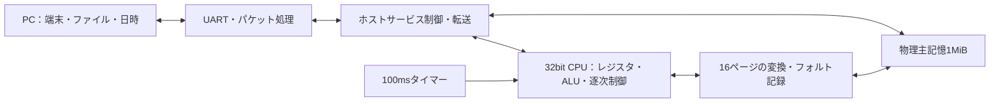

# Simple OS の独自32bit ISAをFPGAへ実装する

## 目的と基準版

既存のアセンブラと `os.asm` を保ち、独自CPUをFPGA化してSimple OSのタスク切替とページフォルトを動かす。最初はUART接続したPCがホストサービスを提供する。w11のRTLや書籍の構成とは独立した開発資料である。

- 公開元：<https://github.com/sueyasu/os_book_code>
- 基準コミット：`d377b03a8ca71f443474fa6c549fd710deaafedf`
- 動作の出典：同版の `emu.py`、符号化の出典：`asm.py`、OSの要求：`os.asm`
- 公開元はMITライセンス。コードを取り込む際は原著作権表示・ライセンスを保持する。
- 初期の基板候補は所有するArty S7。Tang Primerは今回購入・移植しない。

## CPUの互換仕様

| 項目 | 基準版の動作 |
| --- | --- |
| 命令 | 32bit。上位4bitが形式、次の4bitがオペコード |
| レジスタ | 0〜9がR0〜R9、10〜15がTP/SP/PC/PT/VT/CR。特殊レジスタもMOV等で読み書きする |
| オペランド | rdはbit23:20、rsはbit19:16、即値はbit19:0の符号なし20bit |
| 形式 | 0=無オペランド、1=単一レジスタ、2=レジスタ間演算、3=レジスタ間接メモリー、4=即値演算、5=絶対番地メモリー、6=即値分岐・SYSCALL |
| バイト順 | 命令・16/32bitデータはビッグエンディアン。非整列アクセスも許す |
| 主記憶 | 1MiB。通常のメモリーアクセスの開始番地は20bitへマスク |
| 初期状態 | 全レジスタ0、SP=0xFF000、PC=0x80000、MMU無効。OSイメージは物理番地0から配置 |
| フェッチ | 命令を読むことに成功した後、実行前にPCを4進める |
| 即値 | 負値もアセンブラで20bitへマスクされる。符号拡張しない |
| 算術 | ADD/SUB/MUL/INC/DEC等は結果を32bitに切り詰める。ADT/SBTはフラグだけ更新 |
| フラグ | 結果0ならCR.bit2、負ならbit0、0xFFFFFFFF超ならbit1。それ以外0。上位4bitだけ保存して他の下位bitをクリア |
| 論理演算 | AND/OR/XOR/NOTは算術フラグを更新しない |
| スタック | PUSHでSPを4減らして32bit保存。POPは読んでからSPを4増やす。PUSHの負SPはPythonでは0へ丸める |
| 分岐 | JPZ/JPO/JPUはCR.bit2/1/0を見る。反転条件もある。CALLは次のPCをPUSH |
| 割込み制御 | CR.bit30が有効、bit31がMMU有効。EI/DIはbit30だけ変更 |

乗除算は初期から省略できない。OSの初期化にMULI、スケジューラにMODI、ページフォルト処理にDIVIがある。小さな逐次演算器で実装する。PythonのDIVは `int(d1 / d2)`、MODは `%` である。正常な32bit符号なし入力では整数除算・剰余と比較する。ゼロ除算、無効命令、範囲外状態は互換試験を追加して停止理由を定義する。

## ページ変換・例外

論理番地のbit19:16が16個の論理ページ番号、下位16bitがオフセット。MMU有効時は、物理メモリーの `PT & 0xFFFFF` から16バイトのページ表を読み、各バイトを物理ページ番号とする。0xFFは未割当であり、フォルト番地を記録する。初期表は各タスクのページ0を物理0〜3へ、ページ8〜15を同番号へ割り当て、ページ1〜7を未割当にする。

CPUは命令開始時のCRからMMU状態を決める。Pythonは毎命令ページ表を読み直すため、初期RTLでも更新済み表が次の命令に必ず反映される構成にする。先にTLBを導入しない。

割込みはPC、CRの順でPUSHし、bit30をクリアし、`VT + 4 * 番号` から32bitの遷移先を読む。タイマーは番号0、ページフォルトは番号3。IRETはCR、PCの順でPOPする。通常の割込みは命令間、ページフォルトは割込み禁止中でも受け付ける。

重要なのはフォルト時の保存PCである。フェッチで失敗した場合は未加算、命令のデータアクセスで失敗した場合は加算済み。OSは保存PCとフォルト番地を比較し、必要なら保存PCを4戻す。RTLが常に命令先頭PCを保存すると既存OSと食い違う。

ページ境界をまたぐ転送は各バイトで変換する。Python版では後半でフォルトすると、先に書いたバイトや更新済みSP等が残り得る。原子的な書込みや自動ロールバックを勝手に追加しない。境界転送・PUSH/POP/CALLの例外は個別の差分試験で仕様を確定する。物理ページ番号16〜254、空間末尾越えなど、実装がPython例外となる入力は正常系と分ける。

## SYSCALLの配置

SYSCALLはOSへの通常のトラップではなく、エミュレータ内のサービスを直接実行する。自動で割込みフレームを積まない。引数はR8/R9。サービス完了まで現在命令を完了させず、命令間で割込みを扱う。

| 番号 | 機能 | 初期実装の担当 |
| --- | --- | --- |
| 0/1 | 文字/文字列表示 | CPUのメモリー読み出し＋PCの端末表示 |
| 2 | Python書式による整数表示 | PC。まず配布例の書式を集め、対応範囲を明記 |
| 3 | タスク別入力。入力なしはR8=0 | FPGAの受信FIFO。PC応答を無期限に待つ方式にしない |
| 10 | Unix時刻をR8へ返す | PCから時刻を取得 |
| 11 | R8とTP/10から日時表示 | PCで基準版と同じ日時計算・書式 |
| 20 | レジスタ表示 | CPUのスナップショットをPCへ送る |
| 21 | dir/のファイル一覧 | PCの指定ディレクトリ |
| 22 | ファイルを物理0へロードし、PCをPUSHして0へ分岐 | PCがデータ提供、FPGAが物理書込み・CPU状態更新 |
| 23 | タスクページへプログラムロード（最大64KiB） | PCがデータ提供、FPGAがページ表から物理配置先を選ぶ |
| 30 | 現在タスク番号の更新 | FPGAのコンソール選択レジスタ。idleタスク4も扱う |
| 40 | 256バイトの論理/物理メモリーダンプ | FPGAで読出し、PCで整形 |
| 41 | フォルト論理番地をR8へ返す | FPGAのフォルト番地レジスタ |

文字列はNUL終端。Pythonの文字列出力では7bit化とバックスラッシュ列の解釈があり、既存 `.STRING` は改行やANSIコードを文字列として持つ。初期はPC側にこの解釈を残す。UARTへメモリーのバイトを直接流すだけでは表示互換にならない。

PCには四つの仮想コンソールの表示履歴と入力先を持たせる。入力パケットはコンソール番号を持ち、FPGAは四つのFIFOへ振り分ける。タスク4の入出力は表示中コンソールへ送る。通信パケットは種別・要求番号・長さ・チェック値を持つ。ファイル転送中はCPUを停止してDMA書込みを完了させ、通常文字と制御パケットを混在させない。

タイマーは100ms周期。Pythonは有効時だけ割込みをキューへ追加する。最初は単一保留bitと決めつけず、長いサービス中の複数保留・禁止時の扱いを比較する。PCサービス待ちは命令を停止するが、タイマーと入力受信は継続する。通信タイムアウト時はCPUを診断可能な停止状態にし、黙って成功を返さない。

## 回路の構成案と実装順



1. 参照モデルの命令境界トレースを用意する。レジスタ16本、PC、CR、メモリー更新、フォルト、サービス呼出しを記録する。ホスト時刻と入力は固定し、タイマーも命令境界から注入する。
2. 基板に依存しないVHDL CPUを実装する。同期メモリーのrequest/ready、byte enable、サービスrequest/responseを定義し、fetch/decode/execute/memory/commitの複数クロックで進める。PC/SP/CR自身をオペランドとするケースも比較する。
3. 全命令とMMU・割込みを差分試験する。既存サンプルだけでなく、桁あふれ、非整列、ページ境界、フォルト再実行、割込みの保存順を含める。
4. シミュレーションの1MiBメモリーで、OS起動、入力なしのyield、複数タスク、sleep、pagefault.asmを確認する。ホストサービスの模擬実装を使う。
5. Arty S7へ移す。1MiBは小さな内部RAMだけに縮めず、既存DDR3制御と接続可能かを調べる。高番地のスタック・ページ表・ベクター、空きページ割当があるため、初期段階からアドレス配置を保つ。
6. UART支援で実機OSを動かす。その後、SD・表示整形・時刻の処理を置き換えて単体動作へ進む。

## 2026-10-12の実行結果

新規取得した基準版の10個の `.asm` を公開元アセンブラで別々にアセンブルし、全て終了コード0。`os.bin` は1,046,544バイト。高番地のベクター表までゼロ埋めされたイメージであり、このサイズからCPU回路規模を推定しない。

`check_reference.py` は公開元のCPU関数をそのまま読み込み、端末・子プロセス起動を省き、時刻と入力を固定した。OSの初期化、MMU有効化、Welcome表示、`exit`入力、bye表示、HALTまで合格した。割込み・タスク切替・ページフォルト・FPGA回路の合格を意味しない。

再実行：

```sh
git clone https://github.com/sueyasu/os_book_code.git /tmp/os-book-isa-review
git -C /tmp/os-book-isa-review checkout d377b03a8ca71f443474fa6c549fd710deaafedf
python3 Docs/SimpleOS-FPGA/check_reference.py /tmp/os-book-isa-review
```

基本ISAのVHDL CPUと、SYSCALLの位置で全レジスタを比較する試験を [experiments/simpleos_fpga](../README.md) に追加した。基本試験20か所・320比較が合格した。ユーザーが用意した [Simple-C](https://github.com/itoh5588/Simple-C) のビット演算サンプルをコンパイルして追加し、21か所・336比較も合格した。

Simple-Cの上流基準版5542998との違いを調べ、CPU・アセンブラ・OSの仕様差はなく、端末の改行修正が同等であることを確認した。今後はSimple-Cの呼出規約（スタック引数、R0戻り値、R4〜R7保存）と、C版Simple OSも動作対象に加える。

MMU、ページフォルト、割込み受付、IRETを追加し、元のOSとC版OSでタスク切替・ページ割当て・復帰・終了のシミュレーションが合格した。C版OSは97か所・1552個のレジスタ値と、終了時の主記憶1MiB全体がPython版と一致した。詳細と範囲は実験用CPUのREADMEへ記録した。

LED周期点滅・UARTエコーの独立した接続確認回路を実機で確認した。その後、CPU・16 KiB内蔵RAM・UARTローダー・文字入出力・LED制御を組み合わせた単一プログラム用の回路を追加し、アセンブリ版とSimple-C版のサンプルが実機で正常終了した。これはOS用の1 MiB主記憶を縮小した構成ではなく、MMUとOSを使わず物理コード・スタック番地を保持した接続確認用構成である。OS実機起動にはDDR3接続と残りのホストサービスが必要。UARTはユーザーが使っている外付けアダプターのCOM5/Pmod JCへ移す。現在の実機手順と結果は実験用CPUのREADMEを参照する。
