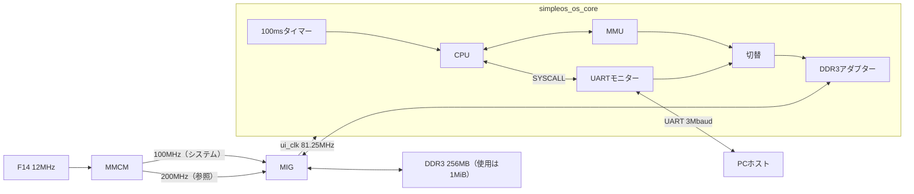

# 回路の構成

| ファイル | 内容 |
|---|---|
| `rtl/simpleos_os_board.vhd` | 最上位。MMCM、MIG、コア |
| `rtl/simpleos_os_core.vhd` | ui_clk上のコア。CPU、MMU、タイマー、UART、UARTモニター、メモリーの切替、DDR3アダプター |
| `rtl/simpleos_cpu.vhd` | CPU |
| `rtl/simpleos_mmu.vhd` | MMU |
| `rtl/simpleos_timer.vhd` | タイマー |
| `rtl/simpleos_uart.vhd` | UART |
| `rtl/simpleos_ddr3.vhd` | DDR3アダプター |
| `board/artys7_os.xdc` | クロック・UART・BTN0・LEDの制約 |
| `board/mig_artys7.prj` | MIGの設定 |

使用量はLUT約6,200（19%）、FF約4,800、ブロックRAMは0。

## クロックとリセット

- F14の12MHzをMMCMでVCO 600MHzにし、6分周の100MHzをMIGのシステムクロック、3分周の200MHzをMIGの参照クロック（IDELAYCTRL用）にする。
- MIGはDDR3を325MHz（tCK 3077ps）で駆動し、その1/4の81.25MHz（ui_clk）を出す。コアはすべてui_clkで動かし、クロック乗換えを置かない。
- R2の100MHzを使わないのは、R2のクロック領域のMMCMをMIGが使うため。自前のMMCMが隣の領域に置かれ、専用のクロック経路を使えず配置が失敗する。Digilentの参考設計も12MHzから作っている。
- BTN0またはMMCMのロック外れでMIGをリセットする（`sys_rst` はLowでリセット）。コアは `ui_clk_sync_rst` が出ている間と、DDR3の較正が終わるまでリセットされる。
- UARTの受信線が20ビット時間以上Lowになる（BREAK）と、コアをリセットしてローダーへ戻る。通常のデータ（0x00を含む）ではLowは最長9ビット時間なので誤検出しない。

## CPU

`simpleos_cpu.vhd` は複数クロックで1命令を実行する。互換仕様は [ISAの互換仕様](isa.md)。

- 転送・算術・論理・条件分岐、CALL/RET、PUSH/POP、1/2/4バイトのメモリー操作、EI/DI、IRET、SYSCALL。
- MUL/DIV/MODは32回の逐次演算。
- メモリーとSYSCALLはvalid/readyで待ち合わせる。要求中は番地とデータを保持する。
- SYSCALL 41（フォルト番地）はCPU内で処理し、それ以外は `host_valid` を出して `host_ready` まで止まる。応答で、R8への書込みと、SYSCALL 22用の「PCを積んで0番地へ分岐」を指示できる。
- 割込み有効フラグ（CRのbit30）をタイマーへ出す。

## MMU

`simpleos_mmu.vhd` は命令開始時に16バイトのページ表を読み込み、その命令の間は保持する。1/2/4バイトの転送をビッグエンディアンのバイト転送に分解し、バイトごとに変換する。未割当（0xFF）のページではフォルトを返し、フォルト番地を記録する。物理側は常に1バイトずつアクセスする。

## タイマー

`simpleos_timer.vhd` は100ms（ui_clkで8,125,000サイクル）ごとに、CPUの割込みが有効なら保留キュー（最大255）に1を積む。CPUが割込みを受け付けるたびに1減る。無効中は積まないが、既にある保留は残す。`emu.py` のタイマースレッドと同じ動作。キューがあふれるとLD5が点灯する。

## DDR3アダプター

`simpleos_ddr3.vhd` は、MMUのバイト転送をMIGネイティブUIのコマンドに変換する。

- x16のDDR3、4:1のPHYなので、UIの1コマンドはBL8の16バイト。番地は `app_addr = 物理番地[19:4] & "000"`、バイトの位置は物理番地の下位4bit。
- 書込みは、16バイトのうち1バイトだけを書くマスクを付けて1コマンドで出す。コマンドとデータはMIGが別々に受け付けるので、両方の受付を待つ。
- 直前に読んだ16バイトを1ライン保持し、同じラインの読出しは2サイクルで返す。書込みはDDR3へ出すと同時に、保持しているラインも更新する。
- 要求は一度に1つ。MIGはSTRICT順序なので、書込みの直後の読出しも新しい値を返す。
- 読出しは、保持ラインに当たらないとき平均20サイクル程度かかる。

## メモリーの切替とUARTモニター

DDR3アダプターの入口は、MMUとUARTモニターで共有する。UARTモニターが使うのは、CPUがリセット中・HALT後・SYSCALLの応答待ちのときだけで、このときMMUは動いていない。PCはこの間に物理メモリーとレジスタを読み書きする。プロトコルは [UARTプロトコルとSYSCALL](protocol.md)。

## MIGの設定

`board/mig_artys7.prj` は、Digilentのボードファイル（`Digilent/vivado-boards` の `new/board_files/arty-s7-50/B.0/mig.prj`、MITライセンス）を元にしている。DDR3の部品（MT41K128M16XX-15E）、ピン配置、タイミング値はそのまま。変更点は次の6つ。

| 項目 | Digilent | このリポジトリ |
|---|---|---|
| モジュール名 | `system_mig_7series_0_2` | `simpleos_mig` |
| ユーザー側の接続 | AXI | NATIVE |
| 順序 | Normal | Strict |
| システムクロック | 単端入力ピン | No Buffer（自前のMMCMから） |
| XADC | 外部から温度を与える | MIG内に生成 |
| 追加UIクロック | 1 | 0 |

生成されるMIGは、app_addr 28bit、データ128bit、マスク16bit、番地の並びはBANK_ROW_COLUMN。
