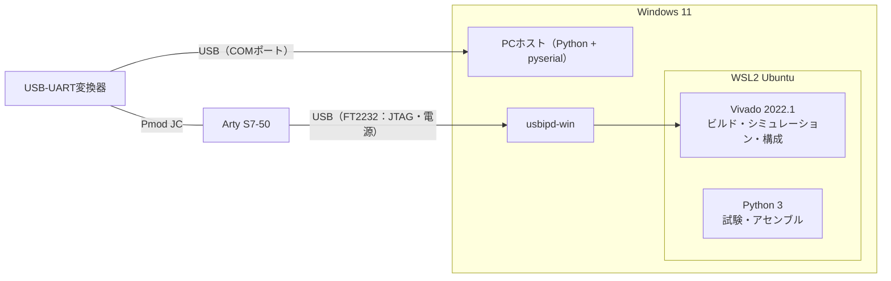

# 開発環境

Windows 11のWSL2（Ubuntu）でVivadoを動かし、回路のビルド、シミュレーション、JTAGでの構成を行う。PCホストはWindowsのPythonで動かし、COMポートでFPGAとつなぐ。すべてLinuxで行うこともできる（[Linuxだけで使う場合](#linuxだけで使う場合)）。

## 全体の構成



| 作業 | 動かす場所 | 使うもの |
|---|---|---|
| MIGの生成、bitstreamのビルド | WSL | Vivado 2022.1 |
| シミュレーション試験 | WSL | Vivado Simulator、Python 3 |
| JTAGでの構成、構成フラッシュの読み書き | WSL | Vivado 2022.1、usbipd-winでWSLへ接続したArtyのUSB |
| OSとサンプルのアセンブル | WSL（Windowsでもよい） | Python 3、os_book_codeの `asm.py` |
| PCホスト、実機の自動確認 | Windows | Python 3、pyserial、USB-UART変換器のCOMポート |

ArtyのUSB（JTAG）とUSB-UART変換器は別々のUSB機器なので、JTAGはWSL、COMポートはWindowsと分けて同時に使える。

## 確認した版

| ソフトウェア | 版 |
|---|---|
| Windows | Windows 11 |
| WSL | 3.0.3（カーネル 6.18） |
| Ubuntu（WSL） | 24.04.3 LTS |
| Vivado | 2022.1（MIG 4.2、Vivado Simulator） |
| Python（WSL） | 3.12 |
| Python（Windows） | 3.13、pyserial 3.5 |
| usbipd-win | 5.3.0 |
| git | 2.43 |

## Vivado

- Vivado 2022.1（ML Standard Edition、無償）のLinux版をWSLのUbuntuに入れる。Spartan-7のデバイスを選んで導入する。
- `board/mig_artys7.prj` はMIG 4.2で確認している。ほかの版のVivadoではMIGの版が変わるため、生成や結果が変わることがある。
- `vivado` コマンドは、`source <Vivadoの場所>/settings64.sh` でPATHに入れる。試験スクリプトは環境変数 `SIMPLEOS_VIVADO_BIN` でVivadoの `bin` を指定する（既定は `/home/itoh/Xilinx/Vivado/2022.1/bin`）。
- JTAGを使うには、Linux版のケーブルドライバー（udevのルール）を入れる。Vivadoの `data/xicom/cable_drivers/lin64/install_script/install_drivers/install_drivers` をrootで実行すると、`/etc/udev/rules.d/52-xilinx-*.rules` が入る。
- Digilentのボードファイルは要らない（MIGの設定は `board/mig_artys7.prj` に入っている）。

## WSLとUSB

WSLからArtyのUSB（FT2232、0403:6010）を使うために、Windowsにusbipd-winを入れる（`winget install usbipd`）。

```powershell
usbipd list                          # BUSIDを調べる
usbipd bind --busid <BUSID>          # 初回だけ。管理者のPowerShellで実行する
usbipd attach --wsl --busid <BUSID>  # 使うたびに実行する
usbipd detach --busid <BUSID>        # Windowsへ戻す
```

接続している間は、Arty内蔵のUSB-UART（COMポート）がWindowsから見えなくなる。このプロジェクトのUARTは外付けの変換器を使うので影響しない。外付けの変換器はWSLへ接続せず、Windowsに残す。

## Python

- WSL：Python 3。試験とアセンブルに使い、追加のパッケージは要らない。
- Windows：Python 3とpyserial（`py -m pip install pyserial`）。PCホストと実機の自動確認に使う。
- WindowsからWSLのファイルは `\\wsl.localhost\Ubuntu-24.04\home\<ユーザー>\...` で開ける。PCホストをWSL側のリポジトリから直接実行してよい。

## USB-UART変換器

WindowsはFTDIのドライバーを自動で入れる。待ち時間タイマーを1msにする（[ハードウェア](hardware.md#usb-uart変換器の設定)）。

## os_book_codeとSimple-C

```sh
git clone https://github.com/sueyasu/os_book_code
git -C os_book_code checkout d377b03a8ca71f443474fa6c549fd710deaafedf
```

- PCホストは、このディレクトリーの `emu.py`・`os.bin`・`dir/` を使う。`os.bin` は `python asm.py os.asm` で作る。
- 試験はこのコミットであることを確かめてから始める。
- 基本ISAの試験とC版OSの試験は、Simple-C（[itoh5588/Simple-C](https://github.com/itoh5588/Simple-C)、`a970ef6736a64916c8659be33403d76b1ba4ff6f`）も使う。C版OSの試験の前に、Simple-Cで `python tools/setup.py` と `python tools/build_simple_os.py` を実行しておく。

## オリジナルの開発環境

os_book_code（`d377b03`）のREADMEとコードから分かる、書籍のエミュレーターの開発環境。

- Python 3.8以降（3.11以降を推奨）。外部のパッケージは使わず、標準ライブラリーだけで動く。
- LinuxかmacOSなどのUNIX系OSが必要。Windows 10/11ではWSLでUbuntuなどを動かして使う。`emu.py` が端末の制御に `termios`・`tty` を使い、タイマーとキー入力を `multiprocessing` の `fork` 方式の別プロセスで動かすため、Windowsでは直接動かない。
- `emu.py` のSYSCALL 40（論理番地のダンプ）は引数なしの `int.to_bytes()` を使っており、これはPython 3.11以降でしか動かない。
- `python asm.py xxx.asm` で `xxx.bin` ができる。`python emu.py` はカレントディレクトリーの `os.bin` を読み込み、`ls`・`exec`・`taskexec` はカレントディレクトリーの `dir/` を使う。`dir/` はリポジトリに無いので、実行するプログラムの `.bin` を自分で置く。

| 項目 | オリジナル | このプロジェクト |
|---|---|---|
| CPU | `emu.py`（Python） | FPGA（Arty S7-50） |
| OS | Linux、macOS、WindowsではWSL | ビルドはWSLかLinux、PCホストはWindowsでもLinuxでもよい |
| Python | 3.8以降（3.11以降を推奨）、標準ライブラリーのみ | 試験はWSLの3.12、PCホストは3.13とpyserial |
| `os.bin` と `dir/` | カレントディレクトリーに置く | PCホストの `--book`・`--os-bin`・`--dir` で指定する |

## Linuxだけで使う場合

WSLではなくLinuxのPCでも、同じ手順で使える。

- usbipdは要らない。ArtyのUSBも変換器も、そのままLinuxにつなぐ。
- PCホストは `python3 tools/simpleos_host.py /dev/ttyUSB0 --book ...` のように、変換器の装置名を指定する。Arty内蔵のFT2232も `/dev/ttyUSB*` として現れるので、取り違えないようにする。
- 待ち時間タイマーは `/sys/bus/usb-serial/devices/ttyUSB*/latency_timer` に1を書いて設定する。
